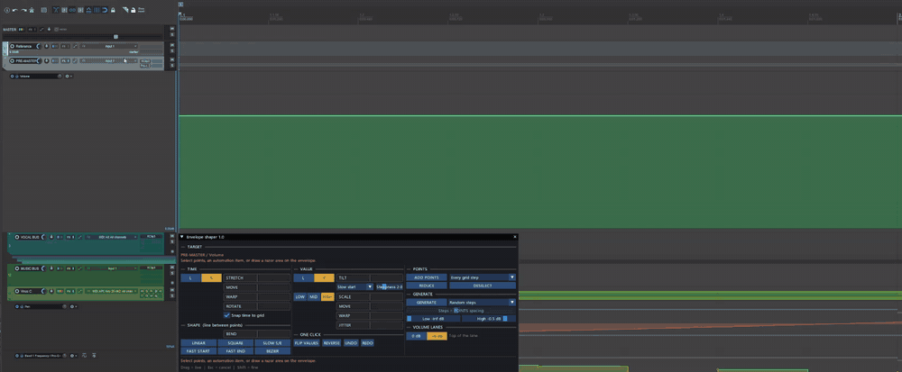

# NH4X REAPER Tools

Free scripts and plugins for REAPER by NH4X. Add this one repository to ReaPack and install whichever tools you want. Music: https://nh4x.bandcamp.com/

| Tool | What it does | Version | Manual |
|---|---|---|---|
| NH4X Envelope shaper | Panel with drag strips to reshape envelopes and MIDI CC / velocity: stretch, tilt, scale, warp, rotate, generate | 1.1 | [below](#nh4x-envelope-shaper) |
| NH4X Volca Drum Suite | Editor panel + step sequencer for the Korg volca drum, plus sound and kit actions | panel 2.6.2 · sequencer 1.1.6 | [volca-drum-suite](https://github.com/NH4Xnet/volca-drum-suite) |



## Contents
1. [Install](#install)
2. [NH4X Envelope shaper](#nh4x-envelope-shaper)
3. [Changes](#changes)
4. [License](#license)

## Install
Do these steps in order, once.

### Step 1 · Install ReaPack
ReaPack is the free package manager for REAPER. Already have it? Go to step 2.

1. Go to https://reapack.com/ and download ReaPack for your system (Windows: `reaper_reapack-x64.dll`).
2. In REAPER: **Options > Show REAPER resource path in explorer/finder**. Open the folder **UserPlugins** (create it if it's missing) and copy the file in there.
3. **Close REAPER and start it again.** The **Extensions** menu now has a **ReaPack** entry.

### Step 2 · Install ReaimGui (for the Envelope shaper)
The Envelope shaper's panel is built with **ReaimGui**. ReaPack doesn't install it for you, so do it first:

1. **Extensions > ReaPack > Browse packages**.
2. Type **ReaimGui** into the filter.
3. Right-click **ReaimGui: ReaScript binding for Dear ImGui** > **Install**, then **Apply**.
4. **Restart REAPER.**

(ReaimGui comes from the *ReaTeam Extensions* repository that ReaPack has by default.)

### Step 3 · Add this repository
1. **Extensions > ReaPack > Import repositories...**
2. Paste this line and click **OK**:

```
https://github.com/NH4Xnet/reaper-tools/raw/main/index.xml
```

This repository also lists the Volca Drum Suite. If you already added the Volca Drum Suite's own repository, keep only one of the two, so the same plugin isn't installed twice.

### Step 4 · Install the tools
1. **Extensions > ReaPack > Browse packages**.
2. Type **NH4X** into the filter.
3. Right-click a tool > **Install**, then **Apply**.

The Envelope shaper now sits in the action list as **Script: NH4X Envelope shaper.lua**. The Volca Drum Suite needs a few more setup steps: see its manual (link in the table above).

## NH4X Envelope shaper
A panel with drag strips that reshape automation envelopes and MIDI editor lanes while you watch. Drag a strip left or right and the shape changes live. Let go = one undo step.

### Start it
- **Actions > Show action list**, search **NH4X Envelope**, **Run**.
- To close it: click **×** on the panel, or run the action again.
- Tip: put it on a toolbar (right-click a toolbar > **Customize toolbar...** > **Add...**, pick the script). The button lights up while the panel is open. Or give it a shortcut in the action list.

### What it edits
The **ENVELOPE / MIDI EDITOR** switch at the top shows what the panel works on. It follows your last click; click it to choose by hand. The **TARGET** line below says exactly what the next move will change.

**Envelopes** (track envelopes, take envelopes, automation items). Click the envelope lane, then:

1. a **razor area** on the lane: everything inside it, or
2. the **selected points**, or
3. a **selected automation item**: the whole item.

**MIDI editor** (CC, pitch bend, channel pressure, velocity). Click the lane, then:

1. the **selected events** (on the velocity lane: the selected notes), or
2. everything inside the **time selection**.

On the velocity lane the panel only changes velocities, so the time controls are grayed out and your notes stay where they are.

### Using the strips
- **Drag** left / right = less / more. The amount shows on the strip.
- **Shift** while dragging = fine control.
- **Esc** while dragging = cancel.
- Rest the mouse on a control for a short tip.

### TIME
- **STRETCH** with switch **L / R**: squeeze or expand in time. L = the left edge moves, R = the right edge moves.
- **MOVE**: shift everything in time.
- **WARP**: bunch the points towards the start or the end. The edges stay.
- **ROTATE**: slide the pattern inside the area; what falls off one end comes back at the other. On the velocity lane it shifts the velocities from note to note, e.g. to move an accent.
- **Snap time to grid**: STRETCH and MOVE land on the grid.

### SHAPE (the line between the points)
- **BEND**: curve the lines between the points. Left = bend down, right = bend up.
- **LINEAR, SQUARE, SLOW S/E, FAST START, FAST END, BEZIER**: one click sets that shape for the whole target.

### VALUE
- **TILT** with switch **L / R**: lift or lower one side, the other side stays. The menu below picks the tilt curve, **Steepness** how strong it is.
- **SCALE** with switch **LOW / MID / HIGH**: make the movement smaller or bigger. LOW = the lowest point stays, MID = the middle stays, HIGH = the highest point stays.
- **MOVE**: shift all values up or down.
- **WARP**: bend the values towards the low or high end. Lowest and highest point stay.
- **JITTER**: random variation per point. Every drag rolls a new pattern.

### ONE CLICK
- **FLIP VALUES**: upside down.
- **REVERSE**: backwards in time.
- **UNDO / REDO**: REAPER's undo, without leaving the panel.

### POINTS
- **ADD POINTS**: fill the target with evenly spaced points on the current line, ready to shape. The menu next to it sets the spacing.
- **REDUCE**: remove points the line doesn't need, e.g. after freehand drawing or a recorded knob move.
- **DESELECT**: unselect all points on the track (in the MIDI editor: all events in the take).

### GENERATE
Replaces the target with a shape.
1. Pick a shape: Ramp up, Ramp down, Swell, Fade, Sine, Triangle, Saw up, Saw down, Square, Random steps, Random smooth.
2. **Cycles**: how many times the shape repeats. The random shapes step at the POINTS spacing (on the velocity lane: once per note).
3. **Low / High**: the range. Shown in dB on volume lanes, in the plugin's own units on FX lanes (e.g. Hz), as MIDI values in the MIDI editor, else in %.
4. Click **GENERATE**.

### VOLUME LANES
The top of volume lanes: **0 dB** or **+6 dB** (default). With 0 dB the panel never pushes volume above 0 dB.

## Changes
- **1.1** · MIDI editor lanes: CC, pitch bend, channel pressure and velocity.
- **1.0** · first public release of the NH4X Envelope shaper.

## License
**CC BY-NC-SA 4.0** (Creative Commons Attribution-NonCommercial-ShareAlike 4.0): https://creativecommons.org/licenses/by-nc-sa/4.0/

- **Free** to use, share and change, as long as it's not commercial.
- **Credit** NH4X and link to this repository.
- **Changed versions** you share must use the same license.
- **Your music is yours.** The license only covers the code.
- **Commercial use of the code** (selling it, bundling it in a paid product) needs a separate license from me. Open an issue on this repository and we'll talk.
